# Dashboard J5 EV — dashboard telematik self-hosted untuk Jaecoo J5 EV

[English](README.md) · **Bahasa Indonesia**

PWA mobile-first yang nampilin angka **asli** yang sebenernya udah dikirim mobilmu —
baterai, jarak tempuh, odometer, sesi pengisian, efisiensi, status ban, kesehatan aki 12 V,
log perjalanan, biaya seumur pakai, perencana pengisian untuk perjalanan jauh, dan peta SPKLU
interaktif.

Ini dibikin karena app bawaan CarLinko nyembunyiin sebagian besar info ini (ban cuma
"normal/abnormal", ga ada total perjalanan, ga ada riwayat biaya charge, ga ada perencana
trip). Semua di sini diturunkan dari data yang **memang sudah** dikirim mobil ke cloud-nya —
project ini cuma baca akunmu sendiri dan nampilinnya dengan benar.

> Dibangun dari mobil nyata, bukan dari lembar spesifikasi. Output biaya charge cocok dengan struk
> PLN Mobile pemiliknya sampai **99,6–99,9 %** (lihat [Akurasi](#akurasi)) — angka itu dari satu
> mobil, karena butuh struk asli untuk diuji. Decode telemetrinya sendiri sudah terkonfirmasi di dua.

> **Mobil CarLinko lain?** Sudah terkonfirmasi di **dua mobil, dua merek, dua jenis penggerak,
> dua negara** — Jaecoo J5 EV (BEV, Indonesia) dan Chery Tiggo 8 PHEV (Afrika Selatan). Semua
> offset byte telemetri identik di keduanya, yang menunjukkan layout blob-nya berasal dari
> platform CarLinko sendiri, bukan dari modelnya. Konstanta yang memang beda per model (skala
> ban, jenis penggerak, foto mobilnya) dibaca dari API saat setup, jadi mobil baru sebagian besar
> mengatur dirinya sendiri.
>
> Catatan yang perlu disebut terus terang: Jaecoo, Omoda, Exeed dan Chery semuanya merek
> **Chery Group**, dan CarLinko itu aplikasi Chery Group — jadi "jalan di CarLinko" realistisnya
> berarti "jalan se-Chery Group", bukan harfiah mobil apa pun. Dua mobil itu sinyal kuat, bukan
> bukti: byte yang belum kami petakan bisa saja beda, dan mobil ICE murni belum pernah dicoba.
> Kalau mobilmu beda, tolong coba & kirim
> [laporan kompatibilitas](https://github.com/GodrezJr2/j5-ev-dashboard/issues/new?template=compatibility.md) ya — satu mobil kedua
> jauh lebih berharga buat proyek ini daripada berapa lama pun menatap yang pertama. 🙏

## Demo

<p align="center">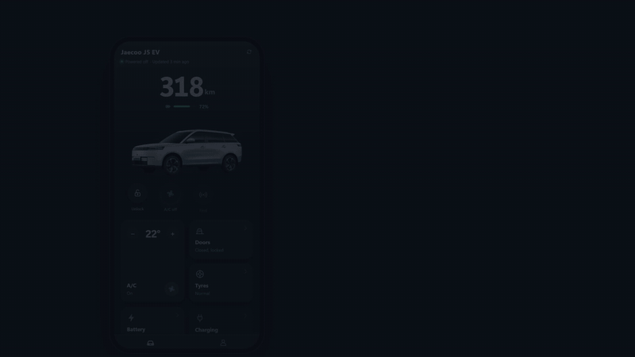</p>

*Satu rekaman utuh tampilan v2 di layar seukuran HP, jalan di mode demo bawaan
(`python server.py --demo`, data contoh, tanpa akun). Diedit di [Motion Studio](https://github.com/GodrezJr2/motion-studio).*

Versi mobil asli: [1½ menit di HP dengan Jaecoo J5 EV asli](https://github.com/user-attachments/assets/f17d167d-cbf9-4eb0-92b4-44361f6da6a5)
(tampilan Classic, plat & VIN disamarkan, bisa juga [diunduh](https://github.com/GodrezJr2/j5-ev-dashboard/releases/download/assets/j5-dashboard-demo.mp4)).

## Screenshot

**Tampilan v2** (default di `/`, juga di `/v2.html`). Gambarnya ikut tema GitHub kamu;
tema terang dan gelap dua-duanya sudah ada.

<table>
<tr><th>Beranda</th><th>Energi</th><th>Jarak</th></tr>
<tr><td align="center" width="33%"><picture><source media="(prefers-color-scheme: dark)" srcset="docs/screenshots/v2-home-dark.jpg">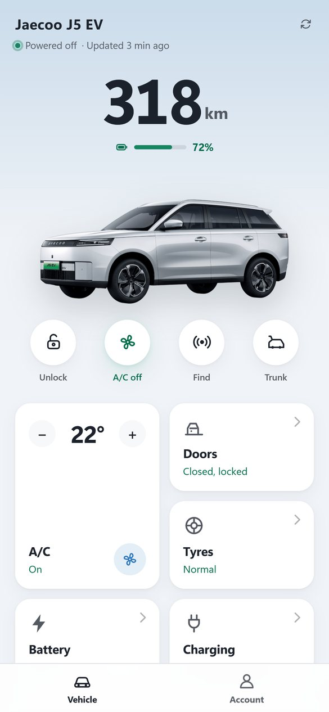</picture></td><td align="center" width="33%"><picture><source media="(prefers-color-scheme: dark)" srcset="docs/screenshots/v2-energy-dark.jpg">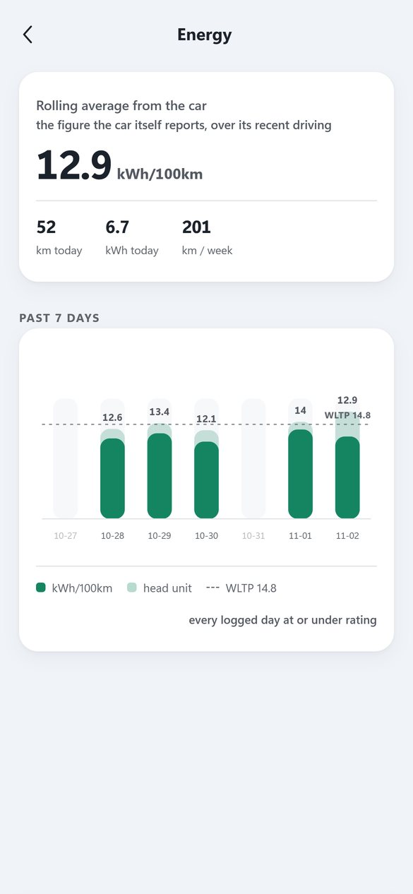</picture></td><td align="center" width="33%"><picture><source media="(prefers-color-scheme: dark)" srcset="docs/screenshots/v2-dist-dark.jpg">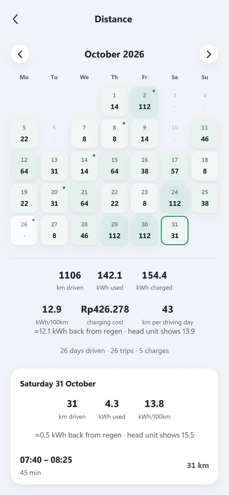</picture></td></tr>
<tr><th>Pintu &amp; jendela</th><th>Pengisian</th><th>Kalkulator cas</th></tr>
<tr><td align="center" width="33%"><picture><source media="(prefers-color-scheme: dark)" srcset="docs/screenshots/v2-doors-dark.jpg">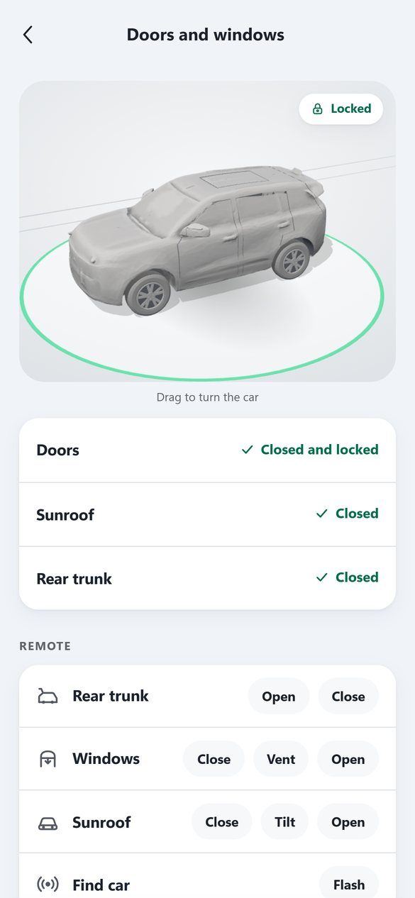</picture></td><td align="center" width="33%"><picture><source media="(prefers-color-scheme: dark)" srcset="docs/screenshots/v2-chg-dark.jpg">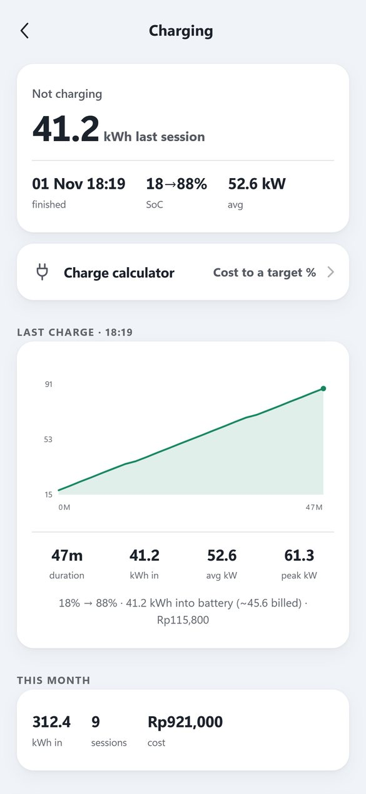</picture></td><td align="center" width="33%"><picture><source media="(prefers-color-scheme: dark)" srcset="docs/screenshots/v2-plan-dark.jpg">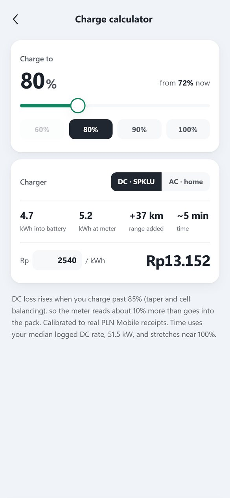</picture></td></tr>
</table>


*Pakai data demo. Plat & VIN disembunyikan secara default (tombol mata privasi).*

**Tampilan Classic** (`/index.html`, atau jadikan default lewat Pengaturan) punya tambahan perencana perjalanan jauh dan peta SPKLU:

<table>
<tr><th>Perencana perjalanan</th><th>Peta SPKLU</th></tr>
<tr><td align="center" valign="top">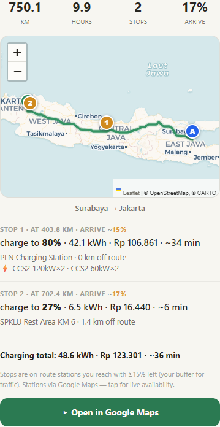</td><td align="center" valign="top">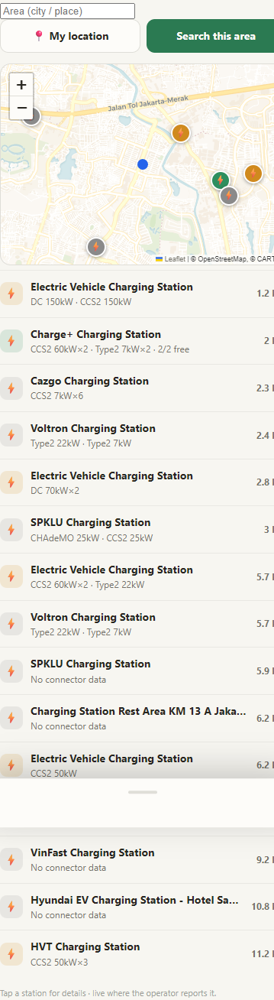</td></tr>
</table>

---

## ⚠️ Legal & etika — baca ini dulu

Ini project **interoperability / reverse-engineering pribadi** untuk akses **mobil dan akunmu
sendiri**. Disediakan untuk keperluan edukasi & pribadi.

- **Pakai hanya dengan akun dan mobil milikmu sendiri.** Jangan akses data orang lain.
- Ini ngobrol sama **API vendor yang privat & tak terdokumentasi**. **Tanpa garansi** dan bisa
  rusak kapan saja kalau vendor mengubah backend-nya. **Tidak berafiliasi, tidak didukung**
  oleh Jaecoo, Chery, maupun CarLinko.
- **Tidak ada data pribadi yang disertakan.** Akun, token, VIN, plat, vehicle id, dan device
  serial-mu cuma ada di `creds.json` yang gitignored (lihat [Setup](#setup)). Kunci penanda-tangan
  request itu **konstanta app** (string yang sama di tiap install CarLinko, gampang dibaca dari
  APK) — di-bundle biar setup cukup email + password; itu bukan rahasia yang terikat ke kamu.
- **Jangan jalankan ini sebagai layanan publik/multi-user.** Itu berarti menyimpan kredensial
  orang lain (yang bisa membuka/mengontrol mobil mereka) dan hampir pasti melanggar ketentuan
  vendor. Deployment yang dimaksud adalah **satu instance per pemilik**, self-hosted, privat
  (mis. di belakang Tailscale). Lihat [Menuju multi-user](#menuju-multi-user).
- Sebagian besar read-only. Tab Control **sudah ada** (kunci, A/C, jendela, sunroof, bagasi,
  find-car, stop charging), tapi statusnya **beta**: cuma *Stop charging* yang opcode-nya
  terkonfirmasi, sisanya hasil decode best-effort dari APK, dan tiap tap itu **aksi nyata di mobil
  nyata** — perhatikan mobilnya waktu dipakai. Juga **cloud-only: belum bisa Bluetooth.** Kontrol
  Bluetooth-proximity yang ada di app CarLinko **tidak** diimplementasikan, jadi mobil harus bangun
  dan punya sinyal seluler; kalau tidak, command-nya gagal (`50043`).

Kalau ga setuju sama poin di atas, jangan dipakai.

---

## Fitur

- **Status live** — baterai %, jarak, odometer, 12 V, status online/parkir/charging/jalan,
  ditarik dari WebSocket realtime dan disimpan di SQLite.
- **Pengisian** — sesi charge terdeteksi otomatis (kWh masuk pack, kWh dibayar di meteran,
  biaya), grafik kurva charge, jumlah mingguan/bulanan, dan perencana "isi sampai X %" dengan
  tarif SPKLU asli. Lonjakan regen difilter biar ga ngotorin riwayat charge.
- **Efisiensi & perjalanan** — kWh/100 km per-trip & rata-rata bergulir dengan pengaman jujur,
  total kWh / biaya / km seumur pakai, dan hemat vs bensin pakai harga BBM Indonesia asli.
- **Perencana perjalanan jauh** — set start/finish, dapat titik charge di sepanjang rute yang
  diukur supaya tiba dengan margin aman (gaya ABRP), lengkap tipe konektor / kW / ketersediaan
  live dari Google.
- **Peta SPKLU** — geser peta interaktif, ketuk charger untuk konektor, ketersediaan live, dan
  petunjuk arah (gaya PLN Mobile), data dari Google Places.
- **Kontrol jarak jauh (beta)** — tab Control yang menembakkan opcode asli `74<cmd><state>` ke
  mobil: kunci/buka, A/C on/off + suhu target, jendela, sunroof, bagasi, find-car, stop charging.
  Hanya *stop charging* yang terkonfirmasi; sisanya label best-effort yang bisa kamu remap dengan
  long-press tombolnya. **Cloud-only — belum bisa Bluetooth.** Lihat
  [docs/control-opcodes.md](docs/control-opcodes.md).
- **Add-on head unit (baru)** — Climate Gesture: atur kipas dan suhu pakai dua jari di head unit J5. Lihat [Add-on head unit](#add-on-head-unit-climate-gesture).
- **Perawatan baterai, hitung mundur servis, tampilan ban, toggle privasi, dark mode, i18n EN/ID.**
- **Home Assistant** — baca semua lewat REST sensor + notif batre-low / charge-selesai. Lihat [docs/HOMEASSISTANT.md](docs/HOMEASSISTANT.md).

Lihat [PRODUCT.md](PRODUCT.md) untuk alasan produk dan [DESIGN.md](DESIGN.md) untuk sistem visual.

## Arsitektur

```
  TCU mobil ─(seluler)─> cloud CarLinko ──┐
                                          │  WebSocket (auth token, tanpa signing) — blob telemetri
   tools/logger.py  ◀──────────────────────┘  decode + simpan tiap frame ke carlinko.db
        │                                      (auth.py auto-refresh token saat kedaluwarsa)
        ▼
   carlinko.db (SQLite)
        │
        ▼
   tools/server.py  ── /api/summary, /api/trip, /api/spklu ──▶  web/ PWA (vanilla JS, Leaflet)
   (http.server stdlib)        + Google Places (opsional)        disajikan lewat Tailscale
```

- **Tanpa framework, tanpa build step.** Backend pakai pustaka standar Python; frontend HTML/CSS/JS
  tulis tangan dengan dua lib vendored (Leaflet, slot-text). Self-hosted & ramah offline.
- **Telemetrinya blob 73 byte.** Offset field dipetakan dengan cara nyetir mobil dan ngeliat byte
  mana yang berubah (baterai = byte 28, range = 29–30 BE, odometer = 18–20 BE, …).
  Lihat [docs/api-map.md](docs/api-map.md).

## Akurasi

Analitik charge dikalibrasi terhadap struk PLN Mobile asli si pemilik:

| Sesi               | Dashboard            | Struk                | Cocok   |
| ------------------ | -------------------- | -------------------- | ------- |
| 58 → 100 %         | 28,9 kWh / Rp 73.491 | 28,94 kWh / Rp 73.521 | 99,9 % |
| 35 → 80 %          | 29,1 kWh / Rp 73.981 | 29,23 kWh / Rp 74.273 | 99,6 % |

Efisiensi charge DC dimodelkan tergantung SoC (isi sampai 100 % rugi lebih banyak dari sampai
80 %), dikalibrasi ke dua struk. Pack terpakai ≈ 58,9 kWh.

Perencana charge memperkirakan yang benar-benar kamu bayar di meteran, dicek terhadap struk
SPKLU PLN Mobile asli:

| Perencana charge di app | Struk PLN Mobile asli |
| :---: | :---: |
| 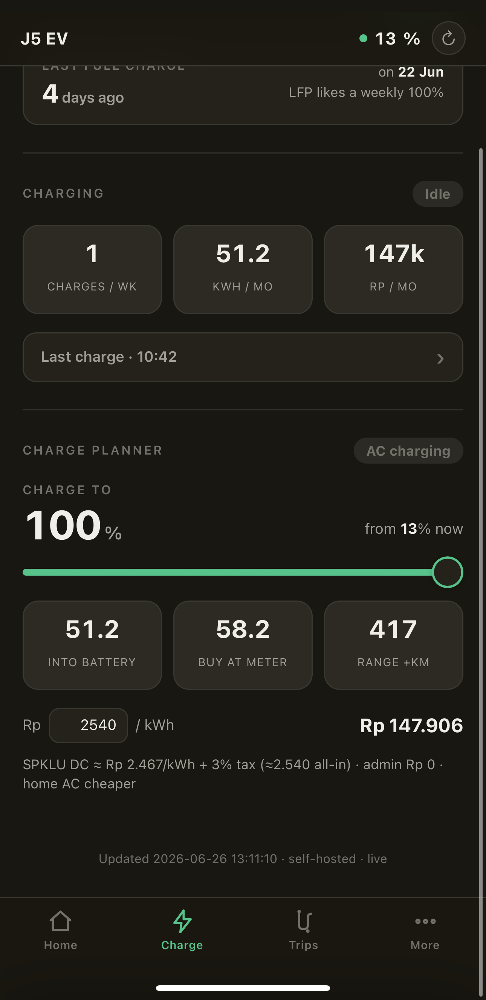 | 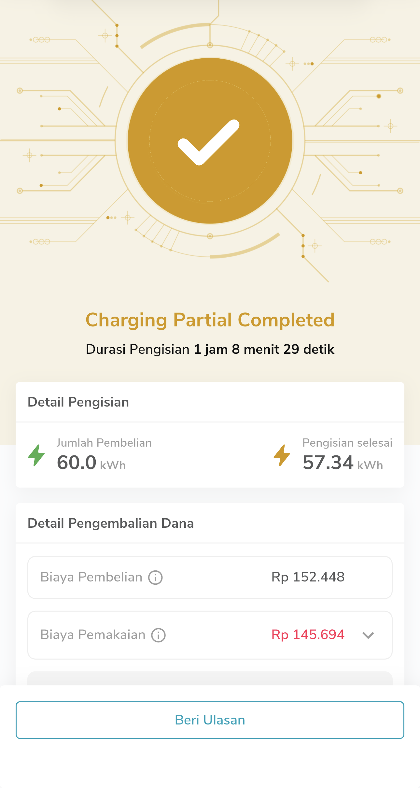 |

App memperkirakan **58,2 kWh** untuk dibeli di meteran @ **Rp 2.540/kWh**; struk menunjukkan
**57,34 kWh** yang benar-benar terkirim pada tarif all-in **Rp 2.540/kWh** yang sama — harga
per-kWh-nya pas dan volumenya meleset ~1,5 % (sesi di struk berhenti sedikit sebelum penuh).
Hitungan refund-nya juga cocok: beli Rp 152.448, terpakai Rp 145.694.

## Coba dulu (demo, tanpa akun)
Mau lihat tampilannya sebelum setup? Jalankan **mode demo** — data palsu tapi realistis, tanpa
akun CarLinko, tanpa mobil, tanpa database:
```bash
cd tools && python server.py --demo      # lalu buka http://localhost:8088
# atau pakai Docker:  docker compose run --rm -p 8088:8088 web python server.py --demo 8088
```
Ada banner 🧪 *Demo mode* biar jelas semua datanya bukan asli. Enak buat lihat-lihat atau screenshot.

## Privasi & keamanan
Semua jalan **di komputermu sendiri** — tidak ada backend yang aku operasikan, dan datamu tidak
pernah dikirim ke server manapun yang aku kontrol. Detail lengkap di **[SECURITY.md](SECURITY.md)**; singkatnya:
- **Email/password** CarLinko kamu disimpan lokal di `tools/creds.json` (di-gitignore) dan dipakai
  cuma untuk login ke cloud **milik CarLinko** (`*.hzhjcl.com`) lewat TLS — sama seperti appnya.
- Panggilan keluar lainnya cuma ke **Google Maps** (kalau kamu isi key) dan layanan peta/rute gratis
  (OpenStreetMap / OSRM) buat perencana trip. Selain itu tidak ada yang keluar dari device-mu.
- Jaga dashboard tetap privat (LAN / Tailscale). Kalau terpaksa kena internet, set
  `dashboard_password` biar `/api/summary` tidak terbuka untuk publik.
- Nemu celah keamanan? Lihat [SECURITY.md](SECURITY.md) — lapor secara privat, jangan buka issue publik.

## Setup

### Prasyarat
- Python 3.10+, `pip install requests websocket-client`
- Akun CarLinko yang ada mobilmu
- (opsional) Google Maps API key untuk perencana trip / peta SPKLU

Tanpa capture app, tanpa MITM, tanpa decompile — cukup login pakai akunmu. (Kunci penanda-tangan
sudah di-bundle, dan blob `v-data` yang dikirim app ternyata diabaikan server, jadi dibuang.)

### Risiko akun — baca dulu
Dashboard ini **tidak resmi**: dia ngobrol ke cloud CarLinko dengan cara yang sama seperti app, tapi
tanpa izin CarLinko. Di November 2026 ada user yang lapor akun CarLinko yang dipakai dashboard-nya
**di-disable** ("Your account has been disabled"). Pemicunya belum diketahui. Akun apa pun yang
kamu loginkan ke dashboard bisa kena hal yang sama, jadi pakai dengan risiko sendiri.

Yang dilakukan dashboard supaya jejaknya kecil: satu socket yang terus terbuka (bukan polling), dan
**login guard**: login ulang otomatis dibatasi 6x per jam, mundur dari 1 menit sampai 30 menit
setelah gagal, dan berhenti total kalau CarLinko menolak akunnya (dashboard lalu menampilkan banner
sampai kamu login ulang manual). Selalu update ke versi terbaru. Versi lama bisa mencoba login yang
gagal setiap beberapa detik.

### Akun kedua (opsional)
CarLinko cuma izinin **satu sesi aktif per akun**, jadi login dashboard bisa nge-logout app
resmi-mu. Bentrok ini bisa dihindari dengan kasih dashboard **akun CarLinko-nya sendiri** (akun
utama jadi tidak ikut, tapi lihat catatan risiko di atas: akun yang dilaporkan di-disable justru
akun kedua):

1. Bikin akun CarLinko kedua (email beda).
2. Dari akun utama, **Me → Authorisation → +** lalu authorise email akun kedua ke mobilmu.
3. Login-kan dashboard ke akun kedua; app tetap di akun utama.

> Catatan: layar *Authorisation* di app menyebut berbagi kontrol Bluetooth — pastikan akun yang
> di-authorise juga bisa narik mobil lewat **cloud** (jalankan `python setup.py` di akun itu; kalau
> auto-deteksi nemu mobilnya, berarti aman). Kalau ga bisa, alternatifnya pakai satu akun saja dan
> terima sesekali login ulang.

### Cara cepat — Docker (disarankan)
```bash
docker compose up -d        # lalu buka http://localhost:8088
```
Pas pertama buka, dashboard nampilin **halaman login** — isi **email + password** CarLinko-mu,
nanti dia login dan **auto-deteksi mobilmu** (vehicle id, device SN, VIN, plat, model). Selesai.
Lebih suka terminal? `docker compose run --rm web python setup.py` melakukan hal yang sama secara
interaktif. Semua yang persisten (creds, token, database) ada di `./data`.

### Cara cepat — satu perintah (Linux, selalu nyala)

Kalau punya mesin yang nyala terus — home server, mini PC, Raspberry Pi — ini mengurus semuanya:
virtualenv, dependensi, login, dan dua service systemd biar selamat dari reboot.

```bash
git clone https://github.com/GodrezJr2/j5-ev-dashboard.git
cd j5-ev-dashboard
./tools/install.sh                 # tambah --tailscale untuk akses dari HP di mana pun
```

Yang ditanya cuma yang memang tak bisa ditebak: login CarLinko dan negara/mata uangmu. Semuanya
terikat ke user dan folder ini — tak ada path yang diasumsikan, tak ada yang dipasang global
kecuali Tailscale kalau kamu minta.

```
./tools/install.sh --tailscale     # + akses privat dari mana saja, tanpa ekspos ke publik
./tools/install.sh --port 9000     # port lain
./tools/install.sh --no-service    # cuma setup; tanpa systemd
```

**Kenapa `--tailscale`?** Logger perlu jalan 24/7 untuk membangun tren, riwayat pengisian dan biaya.
Kamu pasti mau dashboard-nya di HP — tapi ini membaca data mobilmu, jadi **jangan** di-port-forward
ke internet terbuka. Tailscale menaruh mesin dan HP-mu di satu jaringan privat, jadi dashboard bisa
diakses dari mana saja tapi tetap tak terlihat oleh siapa pun. Gratis untuk pemakaian pribadi.

### Cara cepat — Python (manual)
```bash
pip install requests websocket-client
cd tools
python setup.py                # konfigurasi interaktif + login + auto-deteksi mobil
python logger.py --adaptive    # rekam telemetri (cepat saat aktif, lambat saat parkir)
python server.py 8088          # dashboard di http://<host>:8088
```
Ga mau pakai helper? `cp creds.example.json tools/creds.json && chmod 600 tools/creds.json`
lalu isi manual. `creds.json` dan `token.txt` gitignored — jangan pernah di-commit.

Unit systemd rujukan ada di [`tools/`](tools/) kalau mau menulis sendiri
([logger](tools/carlinko-logger.service), [web](tools/carlinko-web.service)) — tapi `install.sh`
sudah membuatkan yang benar sesuai user dan path-mu, jadi harusnya tak perlu.

### Referensi `creds.json`
| key | wajib | apa |
| --- | --- | --- |
| `email`, `password` | ✅ | login CarLinko-mu (plaintext via TLS; disimpan lokal saja) |
| `region` | | region API, default `sea` |
| `vehicle_id`, `device_sn` | auto | vehicle id + serial device — **`setup.py` yang ngisiin** |
| `vehicle` | auto | `{plate, model, vin}` — auto-deteksi; UI sembunyiin plat+VIN default |
| `battery_kwh`, `wltp_kwh_100`, `tariff_idr` | | kapasitas paket berguna + rujukan WLTP + tarif lokal. **Mobil tidak pernah mengirim ukuran paket**, jadi angkanya dari kamu atau dari tabel mobil dikenal di [`tools/known_cars.py`](tools/known_cars.py); model yang belum dikenal ditanya saat setup dan ditandai *asumsi* di UI sampai diisi. Angka ini menskalakan semua kWh, biaya dan efisiensi |
| `gmaps_key` | | Google Maps key — aktifin perencana trip + peta SPKLU (kalau ga, fallback OSM) |
| `dashboard_password` | | set (halaman login → Advanced) untuk kunci dashboard pakai password — **wajib kalau URL-nya bisa diakses dari internet** |

## Mau di-host di mana

Butuh host yang **nyala 24/7** (logger polling terus buat tren + riwayat charge). **HP doang ga
cukup** — iOS ga bisa jalanin server background sama sekali, Android (Termux) gampang dibunuh OS.
Jadi host-nya di tempat lain, HP cuma jadi browser (add to home screen jadi PWA).

| Host | Biaya | Catatan |
| --- | --- | --- |
| PC nganggur / laptop lama / **Raspberry Pi** di rumah | gratis | paling privat; akses lewat [Tailscale](https://tailscale.com) |
| **VPS** murah (Hetzner, Contabo, DigitalOcean…) | ~$4/bln | paling gampang nyala terus; privat pakai Tailscale, atau set `dashboard_password` |
| **Fly.io / Railway / Render** free tier | gratis | deploy Docker image; set `dashboard_password`. Host yang cuma kasih satu service + satu volume bisa jalanin logger bareng dashboard pakai start command `bash railway_start.sh` (lihat bawah) |
| **Oracle Cloud Free / Google e2-micro** | gratis | VM nyala terus gratis |

> **Host publik = wajib set dashboard password.** Di host privat/rumah/Tailscale boleh dibiarin
> kebuka. Begitu URL-nya bisa dicapai dari internet, set `dashboard_password` (halaman login →
> Advanced) biar cuma kamu yang bisa buka.

> **Satu service, dua proses.** `docker compose` jalanin dashboard sama logger sebagai dua
> service yang share `./data`. Host yang nempelin volume ke *satu* service doang (Railway) nggak
> bisa gitu, jadi `tools/railway_start.sh` jalanin logger di background dan dashboard di
> foreground dari satu container. Set jadi start command service-nya — `bash railway_start.sh` —
> dan taruh isi `creds.json` di service variable `CREDS_JSON`; script-nya nulis itu ke volume
> tiap boot. Ini sengaja **bukan** default image: CarLinko cuma ngebolehin satu sesi aktif per
> akun, jadi `docker run` yang diam-diam nyalain logger bakal bikin app CarLinko kamu sendiri
> ke-logout.

### Setup per-OS
Jalur Docker sama persis di semua OS — install Docker, lalu `docker compose up -d` dan buka
`http://localhost:8088`:
- **macOS / Windows**: install [Docker Desktop](https://www.docker.com/products/docker-desktop/), buka, lalu jalanin dua perintah di Terminal / PowerShell dari folder repo yang udah di-clone.
- **Linux**: `sudo apt install docker.io docker-compose-plugin` (atau setara di distro-mu), lalu dua perintah yang sama.

Ga pakai Docker? Install **Python 3.10+** ([python.org](https://www.python.org/downloads/) di macOS/Windows, `sudo apt install python3 python3-pip` di Linux) lalu pakai langkah *Cara cepat — Python* di atas.

### Setup pakai AI coding agent
Kalau ga biasa sama terminal, paste ini ke AI coding agent (Claude Code, Cursor, dll) yang jalan
di mesin yang bakal jadi host:

```text
Set up the open-source project https://github.com/GodrezJr2/j5-ev-dashboard on this machine.
Clone it, then bring it up with Docker (docker compose up -d). It serves a login page on
http://localhost:8088 — tell me the URL when it's running. I'll enter my CarLinko email and
password there myself; do not ask me for them. If Docker isn't available, fall back to the
Python quick-start in the README (pip install requests websocket-client, then run
tools/server.py and tools/logger.py). If the host is reachable from the internet, remind me to
set a dashboard password on the login page's Advanced section.
```

## Add-on head unit: Climate Gesture
Atur kipas dan suhu dari **mana aja di layar head unit** pakai dua jari, tanpa buka layar climate.
Taruh dua jari sekitar sepertiga detik, lalu geser: ke samping = kipas (1 sampai 10), atas/bawah
= suhu (15.5 sampai 30.5 °C). Ada kartu kecil yang nunjukin nilainya. Nyala sendiri tiap
restart. Dites di Jaecoo J5 EV asli (head unit T13J-INTL 00.04.15, Android 12).

**Panduan step-by-step plus gambar ada di dalam dashboard:** jalanin di laptop (Windows: file
`start`, atau `python tools/server.py`), login, lalu **Account → Head unit add-ons**. Cuma mau
add-on-nya? Ga perlu login CarLinko: tap **Only want the head unit add-on?** di halaman sign-in,
atau buka `/addons`. Sekitar 10 menit, mobil parkir, tanpa kabel. Versi singkat:

1. **Engineering menu** — di head unit *Settings → System → Version information*, tap
   *APP Version* 10 kali, isi password = **6 digit terakhir SOC Version**.
2. **Enable ADB** — nyalain di Engineering mode. Yang lain jangan disentuh.
3. **Hotspot yang sama** — nyalain hotspot HP; head unit (*Connection → WiFi*) dan laptop konek ke situ.
4. **Find dan install** — tap *Find head unit*, pilih, *Install*.
5. **Coba** — dua jari, tahan, geser. Habis itu matiin lagi WiFi head unit (CarPlay / Android
   Auto wireless ga jalan selama WiFi nyala); add-on tetap jalan.

Ga perlu backup: cuma install app biasa, ga ada file sistem atau setting mobil yang berubah. Buat
uninstall, buka app Climate Gesture lalu tap **Remove Climate Gesture**. Setelah terpasang, app ini
nutup ADB lewat WiFi jadi device lain di jaringan ga bisa masuk head unit. **Ga resmi** — bukan dari
Jaecoo atau Chery; update head unit bisa bikin ga jalan. Installer ngecek A/C dulu dan nolak head
unit yang ga dikenal. Source: [headunit/climate-gesture](headunit/climate-gesture), APK:
[headunit/dist](headunit/dist) (perintah `adb` manual ada di halaman add-ons).

## Menuju multi-user

Ini sengaja **single-tenant per instance**. Cara bersih biar pemilik lain bisa pakai adalah
dengan **tiap orang menjalankan instance-nya sendiri** dengan `creds.json` masing-masing —
bukan nge-host satu layanan yang menyimpan kredensial semua orang. Model berbeda bisa override
`battery_kwh` / `wltp_kwh_100` / `tariff_idr`, dan nama/VIN/plat kendaraan datang dari
`creds.json`, jadi app-nya udah adaptif per mobil.

## Struktur project
- `tools/` — backend Python (`server.py`, `logger.py`, `auth.py`, `setup.py`) + utilitas reverse-engineering
- `web/` — PWA-nya (satu `index.html` + `leaflet.*` & `slot-text.js` vendored)
- `docs/` — peta API dan catatan signing hasil decompile (rahasia sudah diredaksi)
- `PRODUCT.md`, `DESIGN.md` — catatan produk + desain visual

## Kontribusi
Pemilik Jaecoo / CarLinko lain dipersilakan — [laporan kompatibilitas](https://github.com/GodrezJr2/j5-ev-dashboard/issues/new?template=compatibility.md)
(jalan gak di mobil/region kamu?) paling berguna sekarang. Lihat
[CONTRIBUTING.md](CONTRIBUTING.md), dan [SECURITY.md](SECURITY.md) untuk privasi/keamanan.
Tanya-tanya → [Discussions](https://github.com/GodrezJr2/j5-ev-dashboard/discussions).

## Lisensi
[MIT](LICENSE). Tidak berafiliasi dengan Jaecoo, Chery, maupun CarLinko. Merek dagang milik pemiliknya masing-masing.
